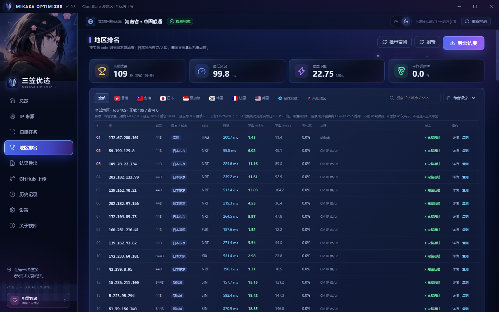
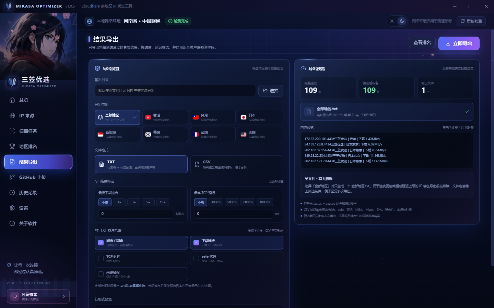
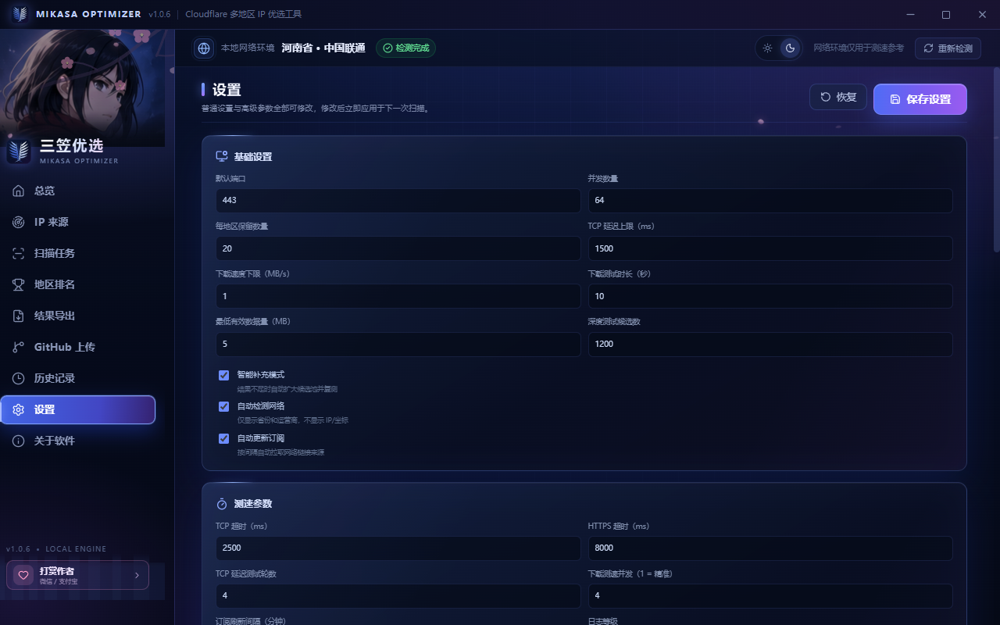

# MIKASA OPTIMIZER · 三笠优选

Windows 10/11 x64 桌面端 Cloudflare 多地区 IP 优选工具。

真实 TCP、HTTPS、colo、延迟与下载测速，支持七地区独立筛选、结果导出、
GitHub 订阅上传、历史复测与浅色/夜间主题。

> 当前版本：`v1.0.5`  
> 作者：`guyue1337`  
> 项目性质：source-available，非商业授权，禁止商用。

## 界面预览

<p align="center">
  
  
  
</p>
<p align="center">
  
  
  
</p>
<p align="center">
  
  
  
</p>

## 已实现功能

- 九页完整桌面界面：总览、IP 来源、扫描任务、地区排名、结果导出、GitHub 上传、历史记录、设置、关于软件。
- 七个首选地区：香港、台湾、日本、新加坡、韩国、法国、美国；全球其他地区达标节点也会保留并显示实际地区。
- 真实四阶段测速：TCP 连通性 → HTTPS/colo 验证 → 多轮延迟 → 实际下载速度。
- 节点名称按真实 colo 显示：香港、台湾、新加坡只显示自身；日本显示东京/大阪；美国显示洛杉矶/圣何塞等城市。
- 多种候选来源：本地 TXT/CSV、粘贴文本、URL 订阅、FOFA、Cloudflare 官方 IP 段、CM IP 库、GitHub Raw、Censys，以及多个社区公开源。
- 统一候选池与来源合并，同一 `IP:端口` 自动去重。
- 综合质量、低延迟、高下载速度三种排名。
- 结果导出支持 TXT / CSV、单地区或全部地区、最低下载速度、最高延迟筛选，以及城市、速度、延迟、colo、来源备注字段自由组合。
- GitHub 上传支持同一套筛选；默认生成 ASCII 路径 `all.txt`、`JP/all.txt`、`US/all.txt` 等，方便脚本直接读取。
- 上传完成后显示 raw 直链、jsDelivr CDN 直链、GitHub 页面和每个分区文件的复制按钮。
- SQLite 本地历史、历史 IP 复测、数据库备份。
- 默认夜间主题，浅色主题逐页适配；侧栏底部提供打赏作者入口。
- 自由之翼徽章用于 EXE、安装包、任务栏、标题栏与侧栏。

## 下载与安装

前往 [Releases](https://github.com/guyue1337/MIKASA-OPTIMIZER/releases/tag/v1.0.5) 下载：

- `三笠优选_1.0.5_x64-setup.exe`：NSIS 安装版，安装到当前用户目录，不需要管理员权限。
- `三笠优选_1.0.5_x64-portable.zip`：便携版，解压后双击 `三笠优选.exe`。
- `三笠优选_1.0.5_source.zip`：源码包，不包含打赏收款码原图、解密密钥、数据库和构建产物。

系统要求：

- Windows 10 x64 1809 及以上，或 Windows 11 x64
- WebView2 Runtime（安装版会自动引导）
- 首次启动和测速需要网络连接

便携版数据库位置：

```text
%APPDATA%\com.mikasa.optimizer\mikasa-optimizer.sqlite
```

## 快速开始

1. 启动软件，等待顶部显示省份与运营商；识别失败可点「重新检测」。
2. 进入「IP 来源」，导入本地 TXT、CM IP 库、Cloudflare 官方段、GitHub Raw、FOFA 或社区公开源。
3. 回到「总览」，选择地区、每地区保留数量、端口、并发、延迟上限、下载时长和测速地址。
4. 点击「开始优选」，在「扫描任务」查看 TCP、HTTPS、colo、延迟、下载与错误日志。
5. 扫描结束后进入「地区排名」查看真实结果，再到「结果导出」筛选并导出。

## 结果导出

- 选择「全部地区」时合并为一个文件；选择单个地区时只导出该地区。
- 速度筛选示例：`5 MB/s 以上`；延迟筛选示例：`500 ms 以内`。
- TXT 备注字段可以只保留城市和下载速度，也可以追加延迟、colo、来源。
- 示例行：

```text
54.250.164.93:443#三笠优选 | 日本东京 | 下载 7.86MB/s
```

- 关闭全部备注字段时只输出 `IP:端口#三笠优选`，方便客户端直接导入。

## GitHub 订阅直链

在「GitHub 上传」点击「开始上传」后，可以先选择：

- 合并全部地区：生成一个 `all.txt`
- 按地区拆分：生成 `HK/all.txt`、`JP/all.txt`、`US/all.txt` 等，并额外生成 `all.txt`
- 最低下载速度、最高延迟
- TXT 备注字段
- TXT 或 CSV

上传完成后可直接复制 raw 直链，例如：

```text
https://raw.githubusercontent.com/guyue1337/MikasaIP/main/mikasa-results/all.txt
https://raw.githubusercontent.com/guyue1337/MikasaIP/main/mikasa-results/JP/all.txt
```

如果希望脚本匿名读取：

1. 把目标仓库改成 **Public**。
2. 确认文件在 `main` 分支。
3. 直接使用 raw 直链，或使用 jsDelivr 加速：

```text
https://cdn.jsdelivr.net/gh/guyue1337/MikasaIP@main/mikasa-results/all.txt
```

私有仓库的 raw 链接需要登录或 Token，脚本无法匿名访问。公开仓库不需要 Token，
路径也不需要放在根目录，放在 `mikasa-results/` 子目录即可。

## 速度与并发说明

- 软件显示十进制 `MB/s`，`1 MB/s = 8 Mbps`。
- v2rayN 等客户端通常显示 `Mbps`，同一个节点会看到约为软件数值的 8 倍。
- 多个 IP 同时下载会争抢本机出口带宽，速度会低于客户端单连接测速。
- 设置页「下载测速并发」改为 `1` 时最接近客户端单连接结果；默认 `4` 更适合批量筛选。

## 常见问题

**某个地区没有结果？**  
Cloudflare Anycast 受本地网络、时段和线路影响，软件只展示真实测速结果。

**为什么 1020 个候选不一定是全池最好的 1020 个？**  
候选窗口按历史成绩、地区配额和新节点探索综合选取。首次导入且没有历史成绩的 IP，
无法在测速前预知绝对最优；软件不会伪造测速结果。

**GitHub 上传 401/403？**  
检查 Token 是否过期、是否具有目标仓库 Contents 读写权限，以及分支是否受保护。

**打赏收款码在哪里？**  
收款码只随正式安装包提供，源码仓库不包含原图和密钥。客户端会校验密文完整性，
但仍无法阻止有能力的逆向者从本地客户端提取，请勿将客户端交给不可信的人。

## 数据与隐私

- 顶部只显示省份和运营商，不显示公网 IP、街道、坐标或城市级位置。
- FOFA、GitHub、Censys 凭据保存在 Windows 凭据管理器。
- 历史记录保存在本地 SQLite，不上传服务器。
- GitHub 上传只上传你确认的测速结果文件。

## 从源码构建

```powershell
cd mikasa-optimizer
npm install
npm run build
npx tauri build
```

构建安装包前需要设置打赏码解密密钥：

```powershell
$env:MIKASA_DONATE_KEY = (Get-Content .env.donation.local | Where-Object { $_ -match '^MIKASA_DONATE_KEY=' }) -replace '^MIKASA_DONATE_KEY=', ''
npx tauri build --bundles nsis
```

没有密钥时，源码可以正常构建，但打赏弹窗会显示「收款码未随源码公开」。

## 许可证

本项目采用 **MIKASA OPTIMIZER 非商业授权许可**：

- 允许个人非商业使用、学习和修改。
- 禁止任何商业使用。
- 转载源码或二进制必须保留作者 `guyue1337` 和仓库链接。
- 发布文章、视频、直播、教程或截图演示时，必须显著注明：
  `MIKASA OPTIMIZER · 作者 guyue1337 · https://github.com/guyue1337/MIKASA-OPTIMIZER`
- 禁止移除品牌、作者署名和许可证声明。

完整条款见 [LICENSE](LICENSE)。这不是 OSI 认可的开源许可证，本项目属于
source-available 项目。第三方依赖许可见 [THIRD_PARTY_NOTICES.md](THIRD_PARTY_NOTICES.md)。

## 作者

`guyue1337`

如果这个工具帮到了你，欢迎在软件内「打赏作者」请作者喝杯奶茶。
